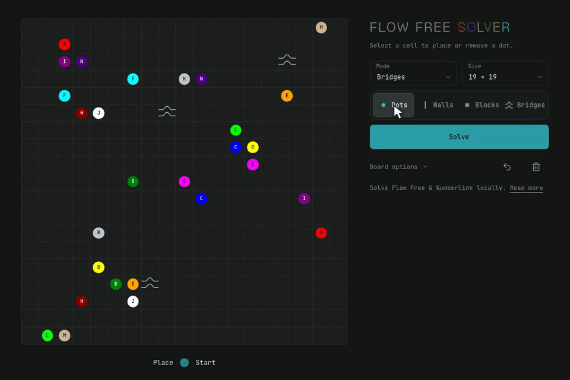

# Flow Free Solver

A fast Flow Free and Numberlink solver with a C/WebAssembly core and a React
editor. It uses pruned DFS with compact path tracking to reject invalid
connections early, plus Z3 fallback for difficult puzzles. All solving runs
locally in the browser.

**[Open the solver](https://flow.kongesque.com/)** ·
[Algorithms](#algorithms) · [Performance](#performance) · [Development](#development)

## Supported puzzles

| Mode | Rules |
| --- | --- |
| **Classic / Numberlink** | Connect matching endpoints and fill every playable cell. |
| **Walls / Courtyard** | Block movement between neighboring cells. |
| **Bridges** | Cross two different colors in independent horizontal and vertical lanes. |
| **Warps** | Connect paths through openings on opposite board edges. |

**5×5 to 19×19**, square or rectangular, with up to **16 colors**. Every mode
supports **blocks** for missing corners, holes, and irregular shapes. Hex boards
and combined Bridges + Warps boards are unsupported.

## Demo

<p align="center">
  
  <br>
  <sub>19×19 Bridges · 14 color pairs · 3 crossings · Solved in 44 ms.</sub>
</p>

## How to solve a Flow Free puzzle

1. Choose a mode and board size.
2. Use **Dots** to place a matching pair for each color. Select a dot again to remove it.
3. Add **Walls** along grid lines, **Blocks** in unused cells, **Bridges** at interior crossings, or **Warps** at board borders.
4. Select **Solve** to see the paths. Use **Edit** to return to the puzzle.

**Undo** reverses edits, **Cancel** stops a solve, and **Reset** clears the board.
Puzzles save locally for each mode. Board options let you choose a solver, add
color labels, and enable guides for press-and-slide placement on mobile.

Blocks cannot contain dots or bridges. Bridges require four playable neighbors;
blocking a warp border closes its opening.

**Keyboard:** arrows move between cells; Enter/Space places an item;
Shift + Arrow edits walls or warp edges; Ctrl/⌘ + Z undoes an edit.

**Generate** gives you a solvable puzzle in any mode. Clear existing walls and
blocks first. Bridges puzzles use 1–3 spaced crossings; generation does not
check uniqueness or rate difficulty.

## Algorithms

| Solver | Boards | Method |
| --- | --- | --- |
| **Pruned DFS** · recommended | All supported modes | Compact frontier and graph searches in C/Wasm. |
| **Z3 SAT** | All supported modes | Exact constraint solving. |
| **A\*** | Classic square boards without walls | TypeScript heuristic search. |

All solvers support blocks on their available board types. Solving runs in
background workers, so the editor stays responsive.

**Classic, walls, and blocks:** search moves diagonally across the grid,
tracking the open ends of unfinished paths. It forces required moves and rejects
cycles and mismatched colors early. Corner rules prune impossible turns across
open, playable contacts. Precomputed patterns handle open rectangles; large
sparse masks first use component/contact checks. Classic paths cannot touch
themselves.

**Bridges and Warps:** graph search treats crossing lanes independently and
adds edges for wrap openings. Circular component lists and local contact masks
keep backtracking updates small. Forced moves, degree checks, endpoint colors,
and crossing constraints reject invalid choices before deeper search. Variants
first try paths without self-touching, then allow it. Heap-based search frames
support long paths on mobile Safari.

When Pruned DFS reaches its search limit, manually entered puzzles automatically
try Z3 with a 30-second budget. Generated puzzles keep a validated solution for
fallback; editing discards it. Each solver returns one complete solution when
found. Difficult puzzles can reach the search limit.

The C core is adapted from [Matt Zucker's flow_solver](https://github.com/mzucker/flow_solver),
with independent frontier techniques inspired by
[Thomas Ahle's Numberlink](https://github.com/thomasahle/numberlink#how-it-works).

## Performance

Compact search state, early pruning, and C/Wasm execution make Pruned DFS fast.
The warmed Wasm total for the 28 Classic fixtures is **0.184 ms**.

The website uses **C/Wasm**. Both columns measure the same C core on Apple
Silicon: native C with Apple Clang 21.0.0 (`-O3`), and Wasm in Node.js 24.21.0.

| Mode | Fixtures | Native C | C/Wasm |
| --- | ---: | ---: | ---: |
| Classic | 28 | 0.133 ms | 0.184 ms |
| Walls | 36 | 0.066 ms | 0.109 ms |
| Bridges | 5 | 0.031 ms | 0.061 ms |
| Warps | 5 | 0.029 ms | 0.062 ms |

Totals represent one solve per fixture: median round totals from one warmup and
11 alternating rounds of 64-call batches. Timing includes parsing, search,
JSON output, and output copying or the JavaScript call boundary. Covers are
independently validated outside the timer. Startup, file/message I/O, generation,
SAT, cached solutions, and drawing are excluded. These fixture timings are not
browser end-to-end latency; results vary by puzzle and device.

Measure the current Wasm solver and run large-board stress checks:

```sh
node scripts/benchmark-wasm.mjs --batch=64 --rounds=11 --output=/tmp/benchmark.json
node scripts/stress-wasm.mjs --rounds=1 --output=/tmp/stress.jsonl
```

## Development

**Node.js 24 LTS + npm.** Built with React, TypeScript, Vite, and WebAssembly.

```sh
npm ci
npm run dev
```

| Command | Purpose |
| --- | --- |
| `npm run build` | Type-check and build the app. |
| `npm run preview` | Serve the production build. |
| `npm run build:wasm` | Compile the C solver. |
| `npm run watch:wasm` | Recompile C during development. |
| `npm run sync:wasm` | Copy matching runtime assets from installed Z3. |
| `npm run check` | Rebuild Wasm and run native, unit, and browser checks. |

Wasm assets are checked in; web development does not require Emscripten. Native
builds and full verification require the version in `.emscripten-version`
(`EMCC` can select the compiler). Install test browsers with
`npx playwright install chromium webkit`.

After C changes, run `npm run build:wasm` and include both generated C artifacts.
Never hand-edit the generated glue or binary. Use `npm run sync:wasm` to keep
Z3's JavaScript and Wasm versions matched.

TypeScript boards use `[x][y]`; C reads text rows and returns row-major data.
Native input uses `.` for empty cells and `#` for blocks. Keep conversions in
`src/solver/logic/heuristic-solver.ts`.

Run `npm run check` before finishing implementation changes. For worker or
asset changes, also verify development and subpath hosting:

```sh
E2E_SERVER=dev npm run test:e2e
VITE_BASE_PATH=/flow-free-solver/ npm run build
VITE_BASE_PATH=/flow-free-solver/ npm run test:e2e
```

Load public assets with `import.meta.env.BASE_URL`. Z3 requires cross-origin
isolation; preserve COOP/COEP in `vite.config.js` and `vercel.json`.

## License

[MIT](./LICENSE), except the heuristic solver adapted from Matt Zucker, which
is covered by [CC BY-NC 2.0](https://creativecommons.org/licenses/by-nc/2.0/):

- `native/flow_solver.c`, `native/diagonal_solver.h`, `native/graph_cover.h`, `native/variant_frontier.h`, and `native/topology_solver.h`
- `public/wasm/flow_solver_c.mjs` and `public/wasm/flow_solver_c.wasm`
- `src/solver/logic/heuristic-solver.ts`

Commercial use requires excluding this module or obtaining a separate license
from its original author.
